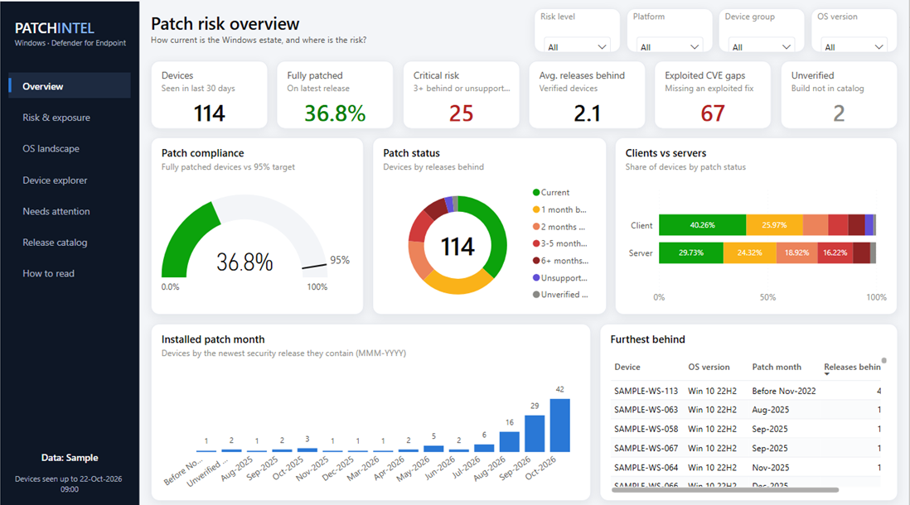
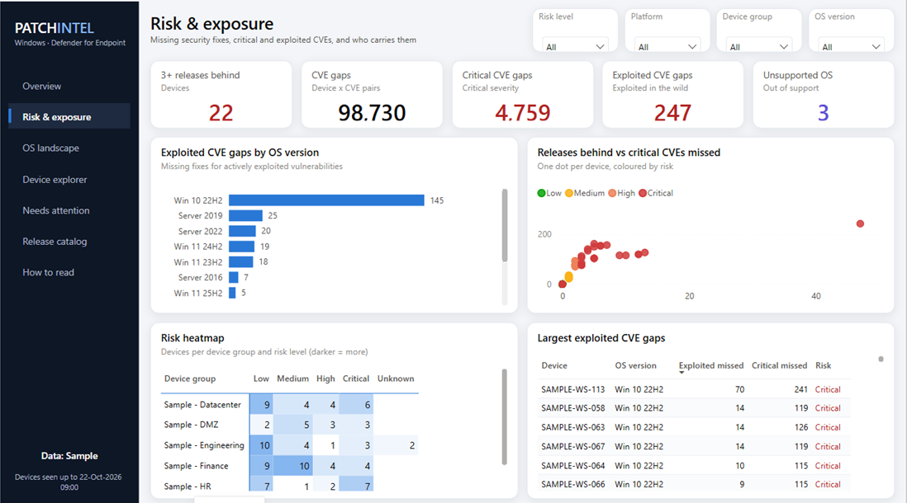

# Windows Patch Level – Power BI report

`Windows Patch Level.pbix` is a modern, app-style report: a dark navigation rail (Ctrl+click in
Desktop, a normal click in the Power BI service), white cards on a light canvas, and dropdown filters in one row that
stay in sync across pages. Status colours appear only where they carry meaning, always with a text label.

| Page | What it answers |
|---|---|
| **Overview** | How current is the estate? KPIs, compliance gauge vs 95% target, status donut, clients vs servers, installed patch month (MMM-YYYY), furthest-behind devices |
| **Risk & exposure** | Where are the missing fixes? CVE / critical / exploited gaps, exploited gaps by OS, releases-behind vs critical-CVE scatter, device-group × risk heatmap |
| **OS landscape** | Which Windows versions are in use and how patched are they? Estate treemap, status share per OS version, OS summary table |
| **Device explorer** | Every device: find by name, filter by status, with build, KB, releases behind, CVE gaps and risk in colour |
| **Needs attention** | Critical and High risk devices only: the hand-off list for the patching team (… > Export data) |
| **Release catalog** | Microsoft releases per Windows version: CVEs fixed per Patch Tuesday, latest release and support status per version |
| **How to read** | Definitions of every status, risk level and data source, and how to switch to your tenant |

It opens with built-in **Sample** devices, so you can see the design straight away. The rail shows
`Data: Sample` or `Data: Defender`.

## Connect it to your Defender tenant (on any device)

1. Install **Power BI Desktop** (Microsoft Store) and open `Windows Patch Level.pbix`.
2. **Home → Transform data (arrow) → Edit parameters** → set **DataSource** to `Defender` → **OK**.
3. Click **Apply changes** (yellow bar) or **Home → Refresh**.
4. When asked for credentials for `https://api.securitycenter.microsoft.com`, choose
   **Organizational account → Sign in**, sign in with your work account, then **Connect**.
   If asked for `https://raw.githubusercontent.com`, choose **Anonymous → Connect**.
5. The rail now shows `Data: Defender`. Save the file.

### Account permissions (least privilege)

The report uses **your own sign-in**. There is no app registration, client secret or stored
password. It can read only what your Defender role allows, and only read. The minimum is:
- Microsoft Defender XDR unified RBAC: a custom role with **Security operations → Security data →
  Read** (covers Advanced Hunting), or the built-in Entra **Security Reader** role.
- If your tenant uses device groups, you'll see only the devices in groups your role covers.

If the refresh fails with *Access is denied / Forbidden*, ask your Defender admin for one of these roles.

### If the refresh fails

| Message | Fix |
|---|---|
| `We couldn't authenticate with the credentials provided` | **File → Options and settings → Data source settings** → select `api.securitycenter.microsoft.com` → **Clear permissions**, then refresh and sign in again |
| `Expression.Error: The field 'Results' of the record wasn't found` | The Defender API returned an error. Usually this is the account's role; also check that the query runs in Advanced Hunting |
| Query takes more than 10 minutes or returns over 100,000 rows | Advanced Hunting API limits. Add a `MachineGroup` filter to `kql/DevicePatchLevel.kql`, rerun `python powerbi/build_pbip.py`, and rebuild the report |

## Publish to the Power BI service (optional)

**Home → Publish** to a workspace, then in the workspace open the semantic model's **Settings →
Data source credentials**: `api.securitycenter.microsoft.com` → **OAuth2** (sign in), and
`raw.githubusercontent.com` → **Anonymous**. Turn on **Scheduled refresh**, e.g. daily 07:00.
Share the report with people who should see device data; they don't need Defender roles to view it,
so share it only with that audience.

## Changing the report

The report is generated by `powerbi/build_pbip.py` into a Power BI project (`powerbi/pbip`). Edit the
generator or edit in Power BI Desktop, then **File → Save as → .pbix**. The device query comes from
`kql/DevicePatchLevel.kql`, so change the KQL and regenerate.
